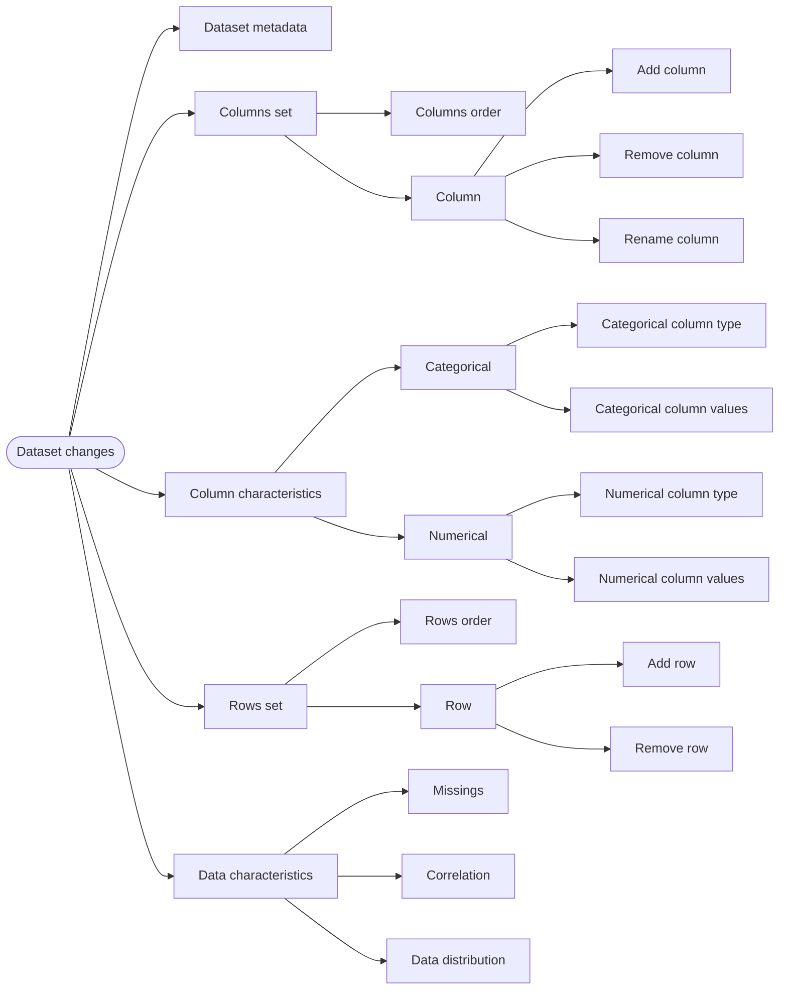

# Taxonomy overview

The taxonomy organises dataset changes into **five complementary dimensions**. Each change type has its own page, with its definition, its implications for ML pipelines and the adaptation it typically requires.

<!-- BEGIN GENERATED:tree -->

<!-- END GENERATED:tree -->

## Index of change types

<!-- BEGIN GENERATED:index -->

| Change type | Dimension |
|---|---|
| [Dataset metadata](dataset-metadata/index.md) | [Dataset metadata](dataset-metadata/index.md) |
| [Columns order](columns-set/columns-order.md) | [Columns set](columns-set/index.md) |
| [Add column](columns-set/add-column.md) | [Columns set](columns-set/index.md) |
| [Remove column](columns-set/remove-column.md) | [Columns set](columns-set/index.md) |
| [Rename column](columns-set/rename-column.md) | [Columns set](columns-set/index.md) |
| [Categorical column type](column-characteristics/categorical-column-type.md) | [Column characteristics](column-characteristics/index.md) |
| [Categorical column values](column-characteristics/categorical-column-values.md) | [Column characteristics](column-characteristics/index.md) |
| [Numerical column type](column-characteristics/numerical-column-type.md) | [Column characteristics](column-characteristics/index.md) |
| [Numerical column values](column-characteristics/numerical-column-values.md) | [Column characteristics](column-characteristics/index.md) |
| [Rows order](rows-set/rows-order.md) | [Rows set](rows-set/index.md) |
| [Add row](rows-set/add-row.md) | [Rows set](rows-set/index.md) |
| [Remove row](rows-set/remove-row.md) | [Rows set](rows-set/index.md) |
| [Missings](data-characteristics/missings.md) | [Data characteristics](data-characteristics/index.md) |
| [Correlation](data-characteristics/correlation.md) | [Data characteristics](data-characteristics/index.md) |
| [Data distribution](data-characteristics/data-distribution.md) | [Data characteristics](data-characteristics/index.md) |

<!-- END GENERATED:index -->

## How each page is organised

- **Dimension pages** define the dimension and list the change types it contains.
- **Change type pages** describe *what changes*, the *implications for the pipeline*, the *typical adaptation* and where the change was *observed in practice*.
