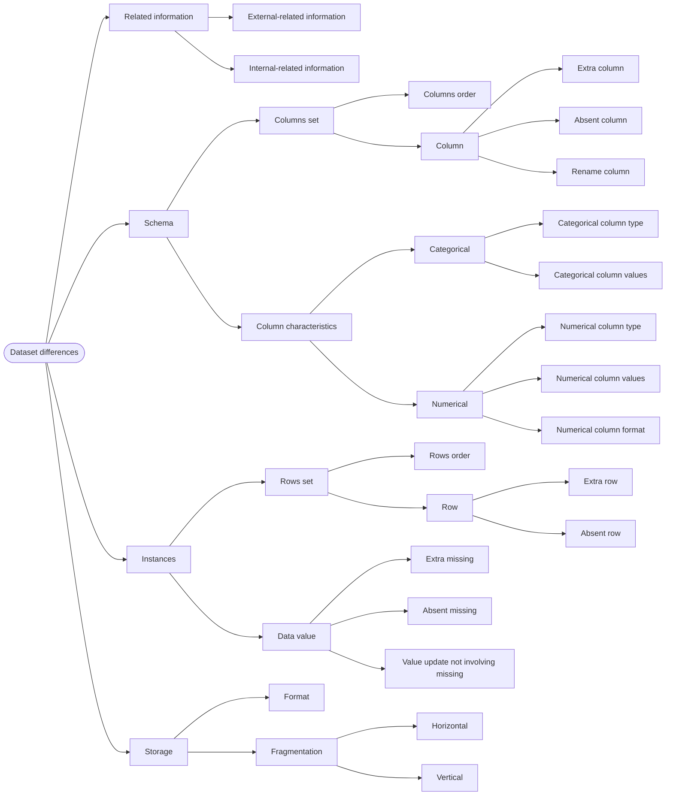

# Taxonomy overview

The taxonomy characterises the **differences between versions of a tabular dataset** that may affect the ML pipelines that use it. It is organised im the following four **Dimensions**:

- **Metadata**: information that describes the dataset as a whole. 
- **Schema**: which columns exist and what characteristics they have.
- **Instances**: which rows are included and which values they hold.
- **Storage**: how the data are physically stored.

Dimensions are divided into **categories** (for example *Columns set*), that can be also divided into **sub-categories** (*Columns order* or *Column*). The concrete categories (not being decomposed, for example *Columns order*) has its own page describing the category.

<!-- BEGIN GENERATED:tree -->

<!-- END GENERATED:tree -->

## How each page is organised

- **Dimension and intermediate category pages** define what they cover and list what they contain.
- **Concrete category pages (leaves)** provide the difference *categoty description*, the *examples of possible implications for the pipeline* and the *typical adaptation*.
