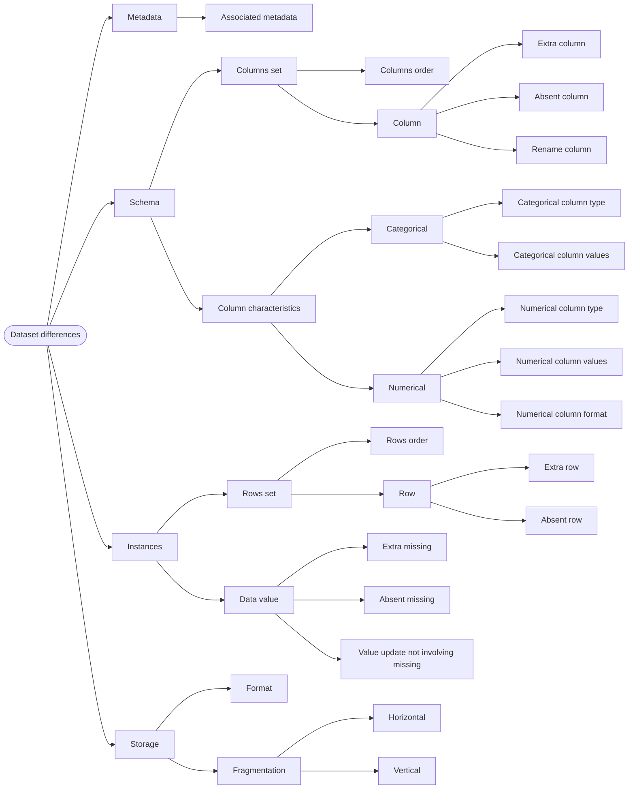

# Taxonomy overview

The taxonomy characterises the **differences between versions of a tabular dataset** that may affect the ML pipelines that use it. It is organised im the following four **Dimensions**:

- **Metadata**: information that describes the dataset as a whole. 
- **Schema**: which columns exist and what characteristics they have.
- **Instances**: which rows are included and which values they hold.
- **Storage**: how the data are physically stored.

Dimensions are divided into **categories** (for example *Columns set*), that can be also divided into **sub-categories** (*Columns order* or *Column*). The concrete categories (not being decomposed, for example *Columns order*) has its own page describing the category.

<!-- BEGIN GENERATED:tree -->

<!-- END GENERATED:tree -->

## Index of change types

<!-- BEGIN GENERATED:index -->

| Difference type | Location |
|---|---|
| [Metadata](metadata/metadata.md) | (metadata/index.md) |
| [Columns order](schema/columns-set/columns-order.md) | [Schema](schema/index.md) › [Columns set](schema/columns-set/index.md) |
| [Extra column](schema/columns-set/column/extra-column.md) | [Schema](schema/index.md) › [Columns set](schema/columns-set/index.md) |
| [Absent column](schema/columns-set/column/absent-column.md) | [Schema](schema/index.md) › [Columns set](schema/columns-set/index.md) |
| [Rename column](schema/columns-set/column/rename-column.md) | [Schema](schema/index.md) › [Columns set](schema/columns-set/index.md) |
| [Categorical column type](schema/column-characteristics/categorical/categorical-column-type.md) | [Schema](schema/index.md) › [Column characteristics](schema/column-characteristics/index.md) |
| [Categorical column values](schema/column-characteristics/categorical/categorical-column-values.md) | [Schema](schema/index.md) › [Column characteristics](schema/column-characteristics/index.md) |
| [Numerical column type](schema/column-characteristics/numerical/numerical-column-type.md) | [Schema](schema/index.md) › [Column characteristics](schema/column-characteristics/index.md) |
| [Numerical column values](schema/column-characteristics/numerical/numerical-column-values.md) | [Schema](schema/index.md) › [Column characteristics](schema/column-characteristics/index.md) |
| [Numerical column format](schema/column-characteristics/numerical/numerical-column-format.md) | [Schema](schema/index.md) › [Column characteristics](schema/column-characteristics/index.md) |
| [Rows order](instances/rows-set/rows-order.md) | [Instances](instances/index.md) › [Rows set](instances/rows-set/index.md) |
| [Extra row](instances/rows-set/row/extra-row.md) | [Instances](instances/index.md) › [Rows set](instances/rows-set/index.md) |
| [Absent row](instances/rows-set/row/absent-row.md) | [Instances](instances/index.md) › [Rows set](instances/rows-set/index.md) |
| [Extra missing](instances/data-value/extra-missing.md) | [Instances](instances/index.md) › [Data value](instances/data-value/index.md) |
| [Absent missing](instances/data-value/absent-missing.md) | [Instances](instances/index.md) › [Data value](instances/data-value/index.md) |
| [Value update not involving missing](instances/data-value/value-update.md) | [Instances](instances/index.md) › [Data value](instances/data-value/index.md) |
| [Format](storage/format.md) | [Storage](storage/index.md) |
| [Horizontal](storage/fragmentation/horizontal.md) | [Storage](storage/index.md) › [Fragmentation](storage/fragmentation/index.md) |
| [Vertical](storage/fragmentation/vertical.md) | [Storage](storage/index.md) › [Fragmentation](storage/fragmentation/index.md) |

<!-- END GENERATED:index -->

## How each page is organised

- **Dimension and intermediate category pages** define what they cover and list what they contain.
- **Concrete category pages (leaves)** provide the difference *categoty description*, the *examples of possible implications for the pipeline* and the *typical adaptation*.
